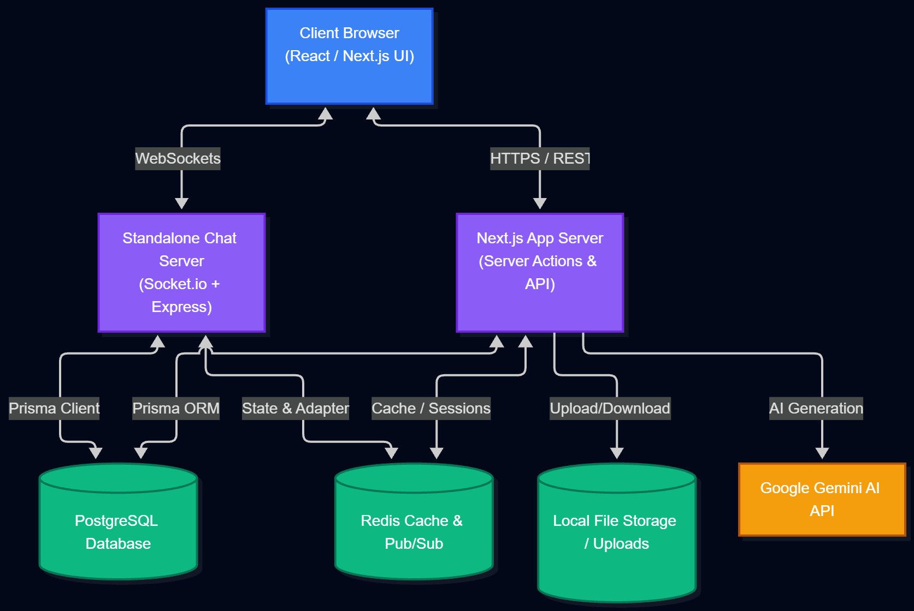
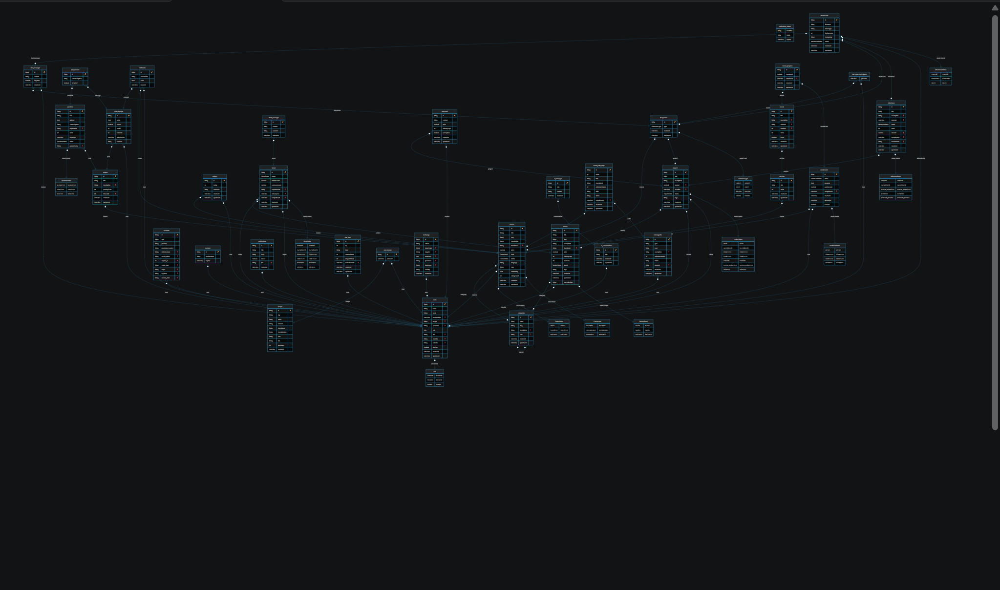

# EduSpark — LMS & Verified Freelance Marketplace

EduSpark is a full-stack educational platform that combines a Learning Management System (LMS) with a gated freelance marketplace. Students learn, pass certification quizzes, and automatically unlock the ability to sell their services as verified creators.

## Key Features

### For Students
- **Course Enrollment & Tracking:** Browse courses, enroll, and track progress. Progress is recomputed transactionally with row-level locks to prevent double-awarding XP under concurrency.
- **Certification Quizzes:** Take quizzes generated by AI or created manually by instructors. Pass the quiz's configured passing score (default 80%) to earn a verified certificate. **Enforcement is server-side**: submitting a quiz requires course completion (`enrollment.isPassed = true`), regardless of UI state.
- **Career Path Generator:** AI-powered (Gemini) personalized learning paths based on career goals, with a robust keyword-based fallback. Transitions are strictly forward-only (`PENDING → IN_PROGRESS → COMPLETED`).
- **AI Assistant:** Context-aware chatbot for platform navigation and support.

### For Creators (Instructors & Freelancers)
- **Course Authoring:** Full curriculum editor (sections, lessons, durations, free-preview flags) plus a lesson attachment manager (PDF, ZIP, images).
- **Course Thumbnail:** Upload, replace, or remove the course cover image. Byte-sniffed (PNG/JPEG/WebP); SVG and HTML disguised as images are rejected.
- **Quiz Builder:** Generate MCQs with Gemini AI or add them manually. Frozen when the course is under admin review.
- **Service Marketplace:** List services gated by holding a relevant certificate. New services start as `PENDING_REVIEW` and only become visible after admin approval. Owners may "withdraw submission" to edit and resubmit.
- **Service Thumbnail:** Same hardened upload pipeline as courses.
- **Project Management:** Handle incoming orders, chat with clients, and manage milestones (delivery note + HTTPS-only URL).

### For Admins
- Full dashboard to manage users, courses, and services.
- **Review gates** for both courses and services: approve, request changes (with reason), or archive. Both flows are audited with admin identity and rationale.
- Cannot self-approve their own content (verified by regression tests).

## Tech Stack

- **Frontend & Backend:** Next.js 16 (App Router, Server Actions)
- **Database:** PostgreSQL + Prisma ORM (v7 with Driver Adapters)
- **Authentication:** NextAuth.js
- **AI Integration:** Google Gemini (`@google/genai`)
- **Real-time Chat:** Socket.io + Redis Adapter
- **Storage:** S3-compatible object storage (MinIO in development) via presigned URLs
- **Rate Limiting:** Redis with atomic Lua scripts (check-before-add semantics)
- **Styling:** Tailwind CSS + Radix UI
- **Infrastructure:** Docker Compose (Postgres, Redis, MinIO), multi-stage Dockerfile for the web app, GitHub Actions CI

## Architecture Overview

The project is a monorepo containing:
1. `eduspark`: The main Next.js application (Frontend + Server Actions).
2. `eduspark-chat-server`: A standalone Node.js + Socket.io server for real-time communication.
3. `eduspark-infra`: Docker Compose files for local infrastructure.

### System Architecture


### Database Schema (ERD)

*(Note: The full detailed ERD is available in `eduspark/docs/ERD.md` due to the large number of tables.)*

## Getting Started

### Prerequisites
- Node.js (v20+)
- Docker & Docker Compose
- A Google Gemini API Key (optional; keyword fallback exists)

### Installation

```bash
# 1. Clone and install (npm workspaces: ONE install at the repository root)
git clone https://github.com/roaaalswidany/EduSpark-WorkSpace.git
cd EduSpark-WorkSpace
npm install

# 2. Environment files (fill in the CHANGE_ME values; secrets are never committed)
cp eduspark/.env.example              eduspark/.env.local
cp eduspark-chat-server/.env.example  eduspark-chat-server/.env
cp eduspark-infra/.env.example        eduspark-infra/.env
#    NEXTAUTH_SECRET (web)  must equal  JWT_SECRET (chat)
#    INTERNAL_API_SECRET    must be the same in web and chat
#    S3_PUBLIC_URL must NOT include the bucket (see .env.example)

# 3. Infrastructure (PostgreSQL, Redis, MinIO)
npm run infra:up

# 4. Database: apply migrations, then create badges / categories / first admin (idempotent)
cd eduspark
npx prisma migrate deploy
ADMIN_EMAIL=you@example.com ADMIN_PASSWORD='use-12+-characters' npm run bootstrap
cd ..

# 5. Run web + chat together
npm run dev            # http://localhost:3000